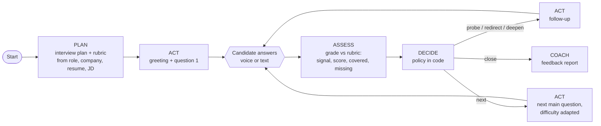

# PrepWise — Self-Directed AI-Assisted Interview Practice

**Live:** https://prepwise-red-xi.vercel.app
**Course:** CS 435 – Human-Computer Interaction (Group Course Project), IIT Gandhinagar, Semester II 2026–27
**Problem statement:** *Self-Directed AI-Assisted Interview Practice Interface*

PrepWise lets anyone practise a realistic mock interview on their own, for **any role**. An AI **interviewer agent** plans the interview,
listens to each answer (by voice or text), asks follow-up questions about what you actually said, adapts its difficulty, and finishes
with specific, actionable feedback. It is free, needs no login, and keeps all practice data in the student's own browser.

> Student course project. Not an official IIT Gandhinagar service.

---

## Contents

1. [Problem](#1-problem)
2. [Gaps in existing solutions and how PrepWise responds](#2-gaps-in-existing-solutions-and-how-prepwise-responds)
3. [Features](#3-features)
4. [How the interviewer agent works](#4-how-the-interviewer-agent-works)
5. [HCI design decisions](#5-hci-design-decisions)
6. [Tech stack](#6-tech-stack)
7. [Free AI models and reliability](#7-free-ai-models-and-reliability)
8. [Project structure](#8-project-structure)
9. [Run it locally](#9-run-it-locally)
10. [Deploy on Vercel](#10-deploy-on-vercel)
11. [Testing we did](#11-testing-we-did)
12. [Development log — everything we built and fixed](#12-development-log--everything-we-built-and-fixed)
13. [Known limitations and future work](#13-known-limitations-and-future-work)
14. [Suggested user study](#14-suggested-user-study)

---

## 1. Problem

Interview preparation usually depends on teachers, mentors, peers or coaches, who are not always available. Students, job seekers and
career changers without that access practise less, feel more anxious, and are unsure how they are doing. AI can make practice available
any time, but it must let people run **realistic, structured and personalised** sessions on their own — not just generate a list of
questions or give a score.

*Example from the brief:* a student preparing for a technical interview practises alone at home but cannot simulate follow-up
questions or get useful feedback without a mentor.

## 2. Gaps in existing solutions and how PrepWise responds

Existing options include question banks, mock-interview platforms, video-recording tools and AI interview assistants (e.g. Yoodli).
The brief notes that their feedback is often generic or focused on easily measured features (pace, filler words), and that they give
limited support for structured, self-directed practice across different interview contexts (see also Daryanto et al., 2025).

| Gap | PrepWise's response |
|---|---|
| Depends on a mentor being available | Fully self-serve, any time, in the browser. No login. |
| Static question lists, no realistic follow-ups | An agent **grades each answer against a rubric** and decides to **probe a specific gap**, **redirect** an off-topic answer, **go deeper** on a strong answer, or move on. |
| Feedback is generic or only about pace and fillers | Five-skill rubric (structure, depth, specificity, communication, delivery). Strengths and improvements quote **what you said**, plus an outline of a strong answer. Pace and fillers are only one of the five. |
| Not adaptable to different interview contexts | **Any role** (tech or non-tech), organisation, career stage, question style, resume and job-description personalisation. The agent **plans a different interview** for each. |
| Not self-directed | The student chooses focus skills, interviewer style, feedback timing and voice; can ask for **Hint / Clarify / Repeat / Skip** at any time; and can **see why** the interviewer asked each question. |
| Anxiety | Supportive interviewer option, hideable live stats, calm visual design, private by default. |

## 3. Features

**Setup (any role)**
- Free-text role plus 7 quick presets: Any role (general), Software Engineering, ML / Data Science, Core Engineering, Product Management, Consulting / Case, HR / Behavioural.
- Organisation, career stage (student, fresher, experienced, career switcher), question style (like the real one, technical, behavioural, mixed, case), 2–8 questions.
- Focus skills (preset chips plus your own), interviewer style (supportive, realistic, tough), feedback timing (after each answer or only at the end), interviewer voice on/off.
- Optional resume and job description so questions are about your real experience.
- A live "Your interview" summary card with the Start button.

**Interview**
- Answer by **voice** (speech-to-text, Indian English) or by typing; the transcript stays editable before submitting.
- Interviewer can **read questions aloud** (text-to-speech).
- Live stats: time, word count, words per minute, filler words, hedging phrases (can be hidden).
- Controls: **Hint**, **Clarify**, **Repeat**, **Skip**, **End & get feedback**, ⌘/Ctrl + Enter to submit.
- **Quick feedback** after each answer (score out of 5 plus one specific tip), if chosen.
- **"Show reasoning" panel**: the agent's interview plan, current difficulty, and every plan / assess / decide step.
- **Reliable on bad networks**: automatic retries, a Retry button, and recovery after a page reload — answers are never lost.

**Report**
- Overall score ring (1–10) with a verdict and a 2–3 sentence summary.
- Skill breakdown with evidence-based notes.
- Delivery stats: speaking pace, filler words (which ones), total words.
- Per question: competency tested, what worked, what to improve, what the interviewer was looking for, and how a strong answer is structured.
- A three-step next-practice plan. Save as PDF (print-friendly).

**Progress**
- Interviews completed, average score, best score, change since the first session.
- Score-over-time chart, average by skill, and a suggested focus area.
- Session list (open a report or resume an unfinished interview, delete a session).

**Branding and design**
- IIT Gandhinagar emblem in the header, landing page and footer, and as the browser-tab icon.
- Light and dark mode, responsive down to phone width, keyboard focus styles, reduced-motion support.

## 4. How the interviewer agent works

The interviewer is an **agent**, not a single prompt. It keeps memory across the interview and runs a perceive → decide → act loop for
every answer:



| Step | Who | What it produces |
|---|---|---|
| **Plan** | LLM (`planLLM`) | N items, each with a competency, question type, the question, 3–5 **expected points** (the rubric), and a hint. Uses the resume and JD. |
| **Assess** | LLM (`assessLLM`) | `signal` (strong / partial / weak / off_topic / no_answer), score 1–5, rubric points covered and missing, a private note, and a coaching tip. |
| **Decide** | **Code** (`policy.ts`) | One action: `probe` (target a missing point), `redirect`, `deepen`, `next`, or `close`, plus an adapted difficulty (1–3). |
| **Act** | LLM (`speakLLM`) | What the interviewer says, in the chosen style, under 70 words (it may be read aloud). |
| **Coach** | LLM (`coachLLM`) | The final report, grounded in the plan, the assessor's notes, the transcript and the delivery metrics. |

**Why the decision is code, not the model:** the LLM *perceives* (grades) and *speaks*, but *what to do next* follows explicit rules.
That keeps the interview structured, bounded in length (at most 2 follow-ups per question), and explainable in the reasoning panel.

Decision rules (`src/lib/agent/policy.ts`):

| Situation | Action |
|---|---|
| Off-topic or no real answer, follow-ups left | **Redirect** — steer back and restate the question more simply |
| Weak or partial answer with a missing rubric point, follow-ups left | **Probe** that specific missing point |
| Strong answer, first time on this question, realistic or tough style | **Deepen** — one harder follow-up (trade-offs, edge cases, "why") |
| Otherwise | **Next** question, or **Close** after the last one |
| Running average ≥ 4.2 / ≤ 2.2 (after 2+ answers) | Raise / lower difficulty for the next question |

**Memory:** the plan, transcript, assessments and difficulty live in the session object. The browser stores it and sends it with each
request, so the server is stateless and any request can be safely retried.

**Fallback brain:** every LLM step has a rule-based equivalent (`brain-offline.ts`: a curated question bank, keyword-based assessment,
template follow-ups, rule-based report). If the AI is unavailable for one step, only that step falls back, and the reasoning panel shows
a `FALLBACK` entry. The interview never gets stuck.

## 5. HCI design decisions

- **Self-direction and control:** the student configures everything, chooses when to get feedback, and can request help (hint,
  clarify, repeat, skip) without leaving the flow.
- **Transparency of AI:** the optional reasoning panel shows the plan, the rubric judgement and the reason for each follow-up, so
  the AI's behaviour is understandable rather than a black box. The report shows what the interviewer was looking for.
- **Actionable feedback over metrics:** feedback quotes the candidate's own words and gives a structure to try next time.
- **Anxiety reduction:** supportive persona, live stats can be hidden, calm colours, encouraging tone, no public scores.
- **Error tolerance:** answers are saved before sending; automatic retry; explicit Retry; recovery after reload; speech-to-text
  transcripts are editable; the grader is told to ignore transcription glitches (e.g. "Major Singh" for "majoring in").
- **Accessibility:** keyboard operable, visible focus rings, ARIA labels on icon buttons, `aria-live` transcript, reduced-motion
  support, light/dark themes, responsive to phone width, voice input and output.
- **Privacy:** no accounts, no database; sessions and resume stay in the browser's local storage. Only the text needed for each turn
  is sent to the AI provider.

## 6. Tech stack

| Layer | Technology |
|---|---|
| Framework | **Next.js 15** (App Router) + **React 19** + **TypeScript** |
| Styling | **Tailwind CSS v4** with design tokens (CSS variables) for light and dark mode |
| AI | Free-tier LLMs via REST: **Groq** (`openai/gpt-oss-120b`, `llama-3.3-70b-versatile`, `openai/gpt-oss-20b`, `llama-3.1-8b-instant`) and **Google Gemini** (`gemini-3.5-flash-lite`, `gemini-3.6-flash`) |
| Structured output | JSON mode + **Zod** schema validation (`z.toJSONSchema` in the prompt, `safeParse` on the result) |
| Voice | **Web Speech API** — `SpeechRecognition` (en-IN) for answers, `speechSynthesis` for the interviewer |
| Storage | Browser `localStorage` (no database, no login) |
| Hosting | **Vercel** (serverless API routes, region bom1) |
| Quality | ESLint (next config), TypeScript strict type-checking |

## 7. Free AI models and reliability

Free tiers are rate-limited **per model** (Groq: about 8,000 tokens per minute per model). `src/lib/llm.ts` therefore keeps a **pool**:

- **Smart tier** (plan, assess, coach): `gpt-oss-120b` → `llama-3.3-70b-versatile` → `gpt-oss-20b` → Gemini Flash-Lite → Gemini Flash
- **Fast tier** (interviewer lines, hints): `gpt-oss-20b` → `llama-3.3-70b-versatile` → `llama-3.1-8b-instant` → `gpt-oss-120b` → Gemini

When a model returns **429 / 503**, it goes on **cooldown** for the time the provider asks, and the next model is tried immediately.
Prompts are kept small (the resume and JD are sent only to the planner and the coach; reasoning effort is set to low), which roughly
halves token use per turn.

On the client, `src/lib/api.ts` adds a **45 s timeout and 3 attempts with backoff**. The server rate-limits each IP to 40 requests per
minute so a public deployment can't burn the free quota.

## 8. Project structure

```
prepwise/
├── README.md
├── .env.example                 # GROQ_API_KEY, GEMINI_API_KEY, optional model pools
├── public/iitgn-emblem.png      # IIT Gandhinagar emblem
└── src/
    ├── app/
    │   ├── layout.tsx           # header (PrepWise + IITGN), footer
    │   ├── icon.png             # browser-tab icon (IITGN emblem)
    │   ├── globals.css          # design tokens, light/dark, utilities (card, btn, chip, input)
    │   ├── page.tsx             # landing page
    │   ├── setup/page.tsx       # interview setup + summary card
    │   ├── interview/[id]/page.tsx  # live interview, voice, retry, reasoning panel
    │   ├── report/[id]/page.tsx     # feedback report
    │   ├── progress/page.tsx        # history, trends
    │   └── api/
    │       ├── agent/route.ts   # POST: one agent turn; GET: is AI configured?
    │       └── report/route.ts  # POST: coach report
    ├── components/
    │   ├── IitgnMark.tsx        # IITGN emblem + wordmark
    │   ├── NavLinks.tsx
    │   └── ScoreRing.tsx        # circular score gauge + score colours
    └── lib/
        ├── agent/
        │   ├── agent.ts         # orchestrator: plan → assess → decide → act, per-step fallback
        │   ├── policy.ts        # decision rules + adaptive difficulty
        │   ├── brain-llm.ts     # planner, assessor, interviewer, coach prompts
        │   └── brain-offline.ts # rule-based brain
        ├── llm.ts               # free model pool with rate-limit rotation
        ├── api.ts               # client fetch with timeout + retries
        ├── guard.ts             # rate limiting + input sanitising
        ├── tracks.ts            # presets, question bank, rubric dimensions
        ├── metrics.ts           # filler words, hedges, words per minute
        ├── useSpeech.ts         # speech recognition + text-to-speech
        ├── storage.ts           # localStorage sessions
        └── types.ts             # shared types
```

## 9. Run it locally

Requirements: **Node.js 20+** and npm.

```bash
cd prepwise
npm install          # first time only (or after copying the folder)
npm run dev          # http://localhost:3000
```

Without API keys the app runs in **offline mode** (built-in questions, rule-based feedback). To enable the AI interviewer, copy
`.env.example` to `.env.local` and fill in at least one key:

```bash
GROQ_API_KEY=...     # https://console.groq.com/keys  (free)
GEMINI_API_KEY=...   # https://aistudio.google.com/apikey  (free)
```

Then restart `npm run dev`. Other scripts: `npm run build`, `npm run start`, `npm run lint`.

Voice input works best in **Chrome or Edge**, with a microphone and a quiet room.

## 10. Deploy on Vercel

The folder is linked to the Vercel project `prepwise` (`.vercel/project.json`).

```bash
npx vercel deploy --prod
```

Environment variables (Vercel → Project → Settings → Environment Variables, then redeploy):

| Variable | Required | Purpose |
|---|---|---|
| `GROQ_API_KEY` | one of the two | Groq free tier (primary) |
| `GEMINI_API_KEY` | one of the two | Google Gemini free tier (backup) |
| `GROQ_MODELS_SMART` | no | Comma-separated override of the smart Groq pool |
| `GROQ_MODELS_FAST` | no | Comma-separated override of the fast Groq pool |
| `GEMINI_MODELS` | no | Comma-separated override of the Gemini pool |

Logs: `npx vercel logs --deployment prepwise-red-xi.vercel.app` (lines start with `[llm]` and `[agent]`).

## 11. Testing we did

| Test | Result |
|---|---|
| End-to-end interview in the browser (setup → interview → hint → follow-ups → report → progress) | Works in offline and AI modes |
| Replaying the exact answer from the "Load failed" bug against production (3 times) | 200 OK in 1.3–1.6 s — the server was fine; the failure was a dropped request in the browser |
| Simulated network failure in the browser (all agent requests rejected) | 3 automatic retries, then a Retry banner; answer kept |
| Reload the page with an unanswered message | The agent reply is recovered automatically |
| Scripted interview against production with weak, off-topic and strong answers (Data Analyst at Swiggy, with resume) | Planner built a resume-based plan; agent **redirected** "I don't know" and an off-topic answer, **probed** a missing rubric point, moved on after a good answer; report generated |
| Rapid-fire stress run (turns sent back-to-back) | Initially hit Groq's per-model limit → fixed with the model pool; rerun had **zero fallbacks**, 1.4–2.9 s per turn, report in 1.7 s |
| Non-tech roles (primary school teacher, mechanical design engineer) | Sensible role-specific plans (e.g. classroom management, lesson planning) |
| Latency comparison | Gemini free tier > 20 s per turn (often overloaded) vs Groq < 1 s → Groq made primary |
| Visual checks | Light mode, dark mode, 375 px phone width (no horizontal scroll) |
| Static checks | `tsc --noEmit` and `eslint` clean |

## 12. Development log — everything we built and fixed

1. **Read the problem statement** (CS 435 PDF) and chose *Self-Directed AI-Assisted Interview Practice Interface*.
2. **First version:** Next.js + Tailwind app with setup, interview (voice + text), report and progress pages; delivery metrics (fillers,
   hedges, words per minute); localStorage history; a curated IITGN-relevant question bank and a rule-based offline engine; deployed to Vercel.
3. **Switched to free AI APIs** instead of a paid API: Google Gemini first, Groq as backup, JSON validated with Zod.
4. **Made Groq the primary provider** after measuring Gemini's free tier at 50 s+ per turn (timeouts) versus Groq at under 1 s.
   Fixed the report praising a slow 72 wpm pace by giving the coach the normal 110–160 wpm range.
5. **Fixed the "Load failed" bug:** the student's answer request was dropped by the browser (Safari) and the app had no recovery.
   Added a client with timeout and automatic retries, a Retry button, and recovery of lost replies after a reload.
6. **Re-designed the interviewer as an agent** (as suggested by the course instructor): Planner → Assess → Decide (policy in code) →
   Act → Coach, with memory, adaptive difficulty, per-step offline fallback, and a "Show reasoning" panel.
7. **Generalised to any role:** free-text role, career stage (incl. career switchers), question style, custom focus skills, a general preset.
8. **Fixed free-tier rate limits for campus-scale use:** a rotating pool of Groq models with cooldowns, Gemini Flash-Lite as backup,
   smaller prompts; also fixed the opener occasionally omitting the first question (now appended in code).
9. **Moved the project to the Desktop** (`~/Desktop/PrepWise-Interview-Practice/prepwise`), reinstalled dependencies, and stopped a
   stale dev server from the old folder.
10. **Added IIT Gandhinagar branding:** emblem in header, hero, footer and as the favicon, with a "not an official IITGN service" note.
    The emblem was cropped from the IITGN Library logo and the sideways "IITGN" text was replaced with a horizontal wordmark so it no
    longer looks tilted.
11. **UI redesign:** new design tokens and components; two-column setup with a live summary card; chat-style interview with avatars,
    typing indicator and a pulsing mic button; report with score ring and colour-coded skills; progress with stat tiles and an area chart.
12. **Wrote this README.**

## 13. Known limitations and future work

- **Free-tier capacity:** roughly a few dozen simultaneous students. Beyond that some turns fall back to the rule-based brain; a paid
  key or more providers would remove this.
- **Voice:** best in Chrome and Edge; Safari support varies; no audio is analysed (tone, pauses) — only the transcript and timing.
- **No accounts:** progress is per browser. A future version could add optional sign-in (e.g. IITGN Google login) and sync.
- **Assessment quality** depends on the free model; the rubric and the explicit policy limit — but don't remove — model mistakes.
- **Ideas:** video/eye-contact feedback, coding-question editor, peer review mode, placement-cell question sets per company,
  multilingual practice (Hindi/Gujarati), "retry this question" drills.

## 14. Suggested user study

For the course's usability evaluation:

- **Participants:** 8–12 IITGN students across branches (include at least two non-CSE and one career switcher).
- **Tasks:** (1) set up an interview for your target role with your resume; (2) complete 3 questions by voice, using a hint once;
  (3) find your weakest skill in the report; (4) open the reasoning panel and explain why the interviewer asked a follow-up.
- **Measures:** task success and time, **SUS** questionnaire, NASA-TLX (workload), perceived usefulness of feedback (Likert),
  pre/post interview-anxiety rating, and a short semi-structured interview.
- **Comparison (optional):** PrepWise vs. a static question list + self-review, within subjects, counterbalanced.

---

Built at IIT Gandhinagar for CS 435 (Human-Computer Interaction). Free for everyone.
